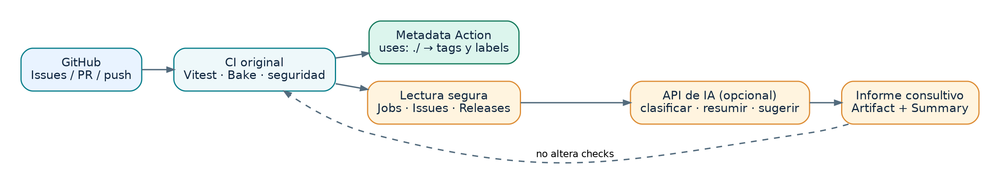
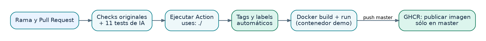
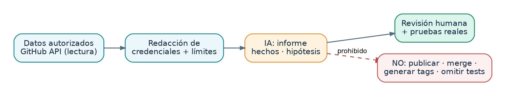
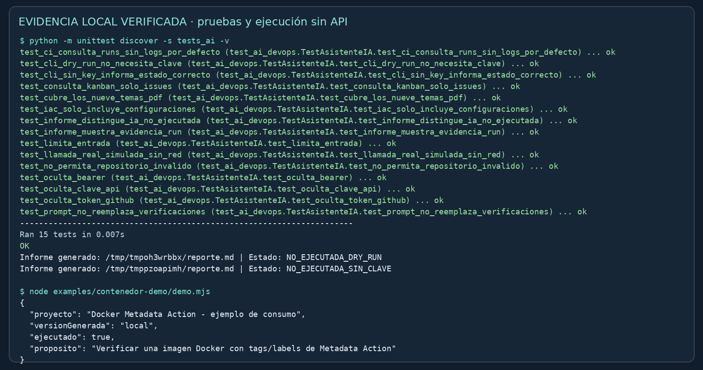

# Implementación de inteligencia artificial y CI/CD en Docker Metadata Action

**Anexo técnico que acompaña al reporte universitario** `RA_DevOps_metadata-action.pdf`.

> **Actualización de alcance académico:** el PDF de 153 páginas corresponde a una **fase anterior de investigación y propuestas** e indica expresamente que todavía no se modificaría el código. Este anexo documenta una **fase práctica posterior**: incorpora archivos nuevos de IA y CI/CD sin reescribir los hallazgos históricos del documento. La nueva evidencia de GitHub debe añadirse después de ejecutar los workflows; nunca se atribuye una ejecución remota no realizada.


## 1. Alcance y verificación

Este ZIP corresponde a Docker Metadata Action, una **GitHub Action en TypeScript** que genera tags, labels, annotations y archivos Docker Bake. **No es un servicio web**. Se conserva intacto el motor de `src/`, `action.yml` y el bundle `dist/index.cjs`. La inteligencia artificial se integra en una capa consultiva (`tools/ai_devops.py`) para respetar el criterio repetido en el PDF: *la IA clasifica, resume, analiza o sugiere, pero no genera tags finales ni salta pruebas o autorizaciones*.

| Estado | Significado |
|---|---|
| **Implementado en este paquete** | Archivos y pruebas incluidos, ejecutables localmente y al subirlos a GitHub. |
| **Ejecutado localmente** | Verificamos el ejecutable de demostración y las pruebas del asistente sin internet ni clave. |
| **Pendiente de ejecución remota** | Publicación real en GHCR, nuevos runs de GitHub Actions, Pull Request real e inferencia con Google Gemini API requieren subir el repositorio y configurar la clave. |
| **No implementado deliberadamente** | IA que apruebe merges, publique releases, cierre alertas o sustituya el generador determinista. |

## 2. Proceso de desarrollo y arquitectura con imágenes



1. El desarrollo ocurre sobre una rama de Git y se propone mediante un **Pull Request**.
2. Los workflows originales (`test.yml`, `validate.yml`, `ci.yml`, CodeQL y Zizmor) realizan verificaciones técnicas.
3. Nuestro workflow `ai-pruebas.yml` valida el asistente con `unittest`, sin utilizar tokens ni APIs externas.
4. El workflow `ai-devops.yml` se activa **manualmente** mediante `workflow_dispatch`, para controlar el uso de la cuota gratuita, seleccionar cualquiera de los **nueve temas** y autorizar explícitamente el envío de datos de repositorios privados.
5. Se recopila información de solo lectura de la API de GitHub. Por defecto se leen **estados de jobs y steps**, no logs completos; esto protege privacidad. La exportación de extractos de logs es opcional con `AI_INCLUDE_LOGS=true` tras revisar su contenido.
6. Si existe `GEMINI_API_KEY` y se cumple el control de privacidad, se consulta **Google Gemini Developer API**, se prepara un **informe consultivo** y se publica como **artifact** del workflow. Sin clave o sin autorización de datos privados, se genera sólo un reporte de evidencia, marcado como **IA no ejecutada**.
7. La Action original permanece independiente y sus tags/labels finales se generan mediante el código del proyecto, **nunca mediante el modelo**.

## 3. Los siete requisitos de la actividad

| Nº | Requisito | Implementación y evidencia esperada |
|---|---|---|
| 1 | Aplicar CI/CD al proyecto | Se mantienen los workflows oficiales y se agregan `ai-pruebas.yml`, `ai-devops.yml`, `demo-imagen-ghcr.yml`. |
| 2 | Explicar desarrollo con imágenes | Figuras 01, 02 y 03 en `docs/imagenes/`, además de evidencia local (figura 04). |
| 3 | Pruebas unitarias, automatización, pull y push | `tests_ai/` con `unittest`; GitHub Actions prueba en PR y push; la Action original conserva Vitest, Bake y CI. |
| 4 | Mostrar en repositorio la imagen automatizada | La imagen **demostrativa** se crea en `demo-imagen-ghcr.yml` y se publica en `ghcr.io/USUARIO/REPOSITORIO-demo` al hacer push a `main`. |
| 5 | Ejecutar código desde el repositorio | El workflow ejecuta el proyecto original con **`uses: ./`**, valida `steps.meta.outputs.json`, ejecuta `demo.mjs` y también `docker run`. |
| 6 | Mantenimiento de software | Nuevo formulario `mantenimiento-devops.yml`, checklist de PR, suite `tests_ai/`, informes de análisis IA por modo `mantenimiento`. |
| 7 | Coincidencia con el PDF | Matriz de trazabilidad de los nueve temas en el apartado 4 de esta guía. |



**Precisión importante:** La imagen de GHCR **contiene el programa de ejemplo**, no convierte al producto GitHub Action en servidor o servicio Docker. Los **tags y labels del contenedor** provienen de la ejecución real de la Action `uses: ./`.

## 4. Aplicación de IA en los nueve temas del PDF

La IA **sí es una implementación funcional opcional** por API (requiere clave); sin clave se pueden probar las partes deterministas y los informes sin inferencia. Cada opción del workflow se conecta con un tema del PDF:

| Tema y página aproximada del PDF | Modo `--mode` | Entrada usada | Resultado de IA previsto | Límite obligatorio |
|---|---|---|---|---|
| 1. Desarrollo continuo, p. 27 | `desarrollo` | Issue abierto o seleccionado | Triage, categoría y pasos de revisión | No fusiona PR. |
| 2. Pruebas continuas, p. 41 | `pruebas` | Issue o ejemplo | Casos límite y regresiones para Vitest | No sustituye aserciones exactas. |
| 3. Integración continua, p. 54 | `ci` | Run ID y jobs/steps | Resumen y posibles causas de fallos | No cambia checks. |
| 4. Entrega continua, p. 66 | `entrega` | Release existente | Borrador de notas y riesgos | No define SemVer como autoridad. |
| 5. Puesta en marcha, p. 79 | `despliegue` | Release existente | Informe de readiness y recuperación | No publica versiones. |
| 6. Supervisión continua, pp. 95–96 | `supervision` | Run ID y estado de jobs | Agrupación de fallos y recomendaciones | No cierra alertas ni ve servidores ajenos. |
| 7. IaC, p. 113 | `iac` | PR con YAML/HCL (o guía sin PR) | Riesgos de configuración y sugerencias | No cambia permisos. |
| 8. Mantenimiento, p. 130 | `mantenimiento` | Issue | Clasificación y pruebas correctivas | No aprueba dependencias. |
| 9. Kanban, pp. 147–148 | `kanban` | Issues abiertos | Backlog, bloqueos y prioridades sugeridas | No evalúa productividad individual. |



### Cómo escoger la opción desde GitHub Actions

En la pestaña **Actions → IA DevOps - informe consultivo → Run workflow**, seleccionar `mode` y, cuando corresponda, introducir `target`:

- `ci`, `supervision`: **ID del run** (número que aparece en el URL de GitHub Actions).
- `desarrollo`, `pruebas`, `mantenimiento`: número del **issue**; si está vacío, analiza un pequeño conjunto de issues abiertos.
- `iac`: número de **Pull Request** con cambios YAML, HCL o Dockerfile (si está vacío, entrega sólo un plan genérico).
- `entrega`, `despliegue`: **tag de release**; si está vacío intenta consultar la release más reciente. Si el repositorio nuevo todavía no tiene releases, este modo necesitará una release real.
- `kanban`: resume hasta 25 issues abiertos.

## 5. Pasos exactos para subir y activar el proyecto

### 5.1. Integrarlo al repositorio

**Si ya existe un repositorio personal en GitHub**, es preferible clonarlo y copiar los archivos de este paquete sobre ese clon para conservar tu historial. El ZIP de entrega **no incluye `.git/`** para evitar transportar historial pesado del repositorio original. **No es necesario reemplazar el proyecto asignado:** estos archivos sólo añaden funcionalidades complementarias.

**Si todavía no existe el repositorio**, crea uno y súbelo a la rama `main` (rama principal del repositorio estudiantil). Desde la raíz del proyecto:

```bash
git init
git branch -M main
git remote add origin https://github.com/USUARIO/metadata-action.git
git add .
git commit -m "feat: IA consultiva DevOps, pruebas y demo GHCR"
git push -u origin main
```

> Reemplaza `USUARIO` con el usuario de GitHub y **no uses `git init` en un clon que ya contiene `.git/`**. Si ya existe un remoto, usa el remoto de tu repositorio y haz sólo add/commit/push. Para mostrar un Pull Request, trabaja en `feature/ia-devops`, sube con `git push -u origin feature/ia-devops` y abre el PR contra `main`.

### 5.2. Configurar el secreto de la IA

En GitHub: **Settings → Secrets and variables → Actions → New repository secret**. Crea `GEMINI_API_KEY` con una clave de API válida. **Nunca la escribas en archivos, capturas, commits o logs**. El modelo predeterminado es `gemini-2.5-flash-lite`, configurable mediante `GEMINI_MODEL` en el workflow o en el entorno local. La modalidad gratuita de Gemini API está sujeta a cuotas y Google puede utilizar solicitudes/respuestas para mejorar sus productos; no enviar información sensible. El asistente no usa ChatGPT ni su suscripción.

El workflow de IA sólo escribe reportes; **no hace cambios de código, merges o releases**. Los informes se muestran en **Summary** y en **Artifacts** del run. Se puede ejecutar sin clave para revisar la recolección de evidencia, pero entonces el estado será `NO_EJECUTADA_SIN_CLAVE`.

### 5.3. Verificar automatización de CI en push y PR

1. Crear la rama `feature/ia-devops` y realizar un commit de una mejora documental.
2. Ejecutar `git push -u origin feature/ia-devops` y abrir un Pull Request contra `main`.
3. En la pestaña **Checks / Actions**, verificar **`IA DevOps - pruebas unitarias`**, los workflows originales `test`, `validate`, `ci` y la demo de imagen.
4. Revisar que **la demo de imagen construye pero NO publica a GHCR desde el PR**.
5. Después de revisar y aprobar, fusionar el PR a `main` o hacer push autorizado a la rama principal.
6. En `main`, el workflow de la demo intentará crear una **imagen demostrativa** automáticamente en GHCR.
7. Para generar el informe de IA, ir manualmente a **Actions → IA DevOps - informe consultivo → Run workflow**. El modo predeterminado `demo_sintetica` usa un caso ficticio; si se desactiva, la API de Google no recibirá evidencias de un repositorio privado a menos que se marque la autorización expresa `allow_private_data`.

### 5.4. Imagen Docker automatizada en GHCR

Ruta esperada: `ghcr.io/USUARIO/metadata-action-demo:latest` si el repo es `metadata-action`. El nombre exacto se calcula como `ghcr.io/OWNER/REPO-demo`, en minúsculas. Se crean también tags de rama/SHA o PR conforme a las reglas de Metadata Action.

En GitHub: **Actions → Demo ejecutable Metadata Action + imagen GHCR → ejecución de `main` → Summary**. Copia imagen y digest. Después revisa **Packages** en el perfil del propietario. Si el paquete se crea privado, cambia su visibilidad a pública si necesitas enseñarlo sin iniciar sesión. El job requiere permiso `packages: write`; revisa la configuración del repositorio/organización si el registro rechaza el push.

En un equipo con Docker instalado, para ejecutar la imagen **después** de publicarla:

```bash
docker pull ghcr.io/USUARIO/metadata-action-demo:latest
docker run --rm ghcr.io/USUARIO/metadata-action-demo:latest
```

**No puede afirmarse que una imagen está publicada hasta comprobar que el job de GitHub terminó correctamente y ver el paquete en GHCR.**

## 6. Pruebas y ejecución local (sin clave ni red)

Ejecutar desde la raíz del repositorio:

```bash
python3 -m unittest discover -s tests_ai -v
python3 tools/ai_devops.py --mode ci --input-file examples/ia/ci-fallido.json --dry-run --output artifacts/reporte-ci-local.md
python3 tools/ai_devops.py --mode mantenimiento --input-file examples/ia/issue-mantenimiento.json --dry-run --output artifacts/reporte-mantenimiento-local.md
node examples/contenedor-demo/demo.mjs
```

En Windows PowerShell se pueden usar `python` o `py` si no existe `python3`. La salida de `--dry-run` **no es inferencia de IA**: sirve para comprobar el formato y la separación entre evidencia y modelo. Al configurar una clave API, quita `--dry-run` para obtener un análisis real. Para evitar mostrar la clave en consola, configúrala mediante el secreto de GitHub.



**Pruebas oficiales**: el repositorio original conserva sus suites de Vitest y Docker Bake. Para ejecutarlas necesitas Node.js 24, Yarn 4 y/o Docker conforme al proyecto base. El entorno local usado para preparar este paquete no contiene sus dependencias instaladas, por lo que **no se afirma que aquí se haya ejecutado toda la suite oficial**. Debe comprobarse en GitHub Actions después del push.

## 7. Mantenimiento de software (tema 8 del PDF)

Se agrega `.github/ISSUE_TEMPLATE/mantenimiento-devops.yml` para registrar versión, categoría correctivo/adaptativo/perfectivo/preventivo, pasos de reproducción, resultado esperado/obtenido y aceptación. Se agrega `.github/PULL_REQUEST_TEMPLATE.md` para exigir evidencia técnica, revisiones y transparencia sobre el uso de IA.

Ciclo recomendado: **issue → reproducir problema → prueba de regresión → corrección en src/ → build de dist/ si corresponde → PR → checks → release autorizada → supervisión**. Un hotfix no puede omitir pruebas por ser urgente. Una deprecación de inputs/outputs debe comunicarse antes de retirar compatibilidad.

Para IA, usar el modo `mantenimiento` sobre un issue existente. Su resultado es un **resumen consultivo**; no modifica dependencias o releases por sí solo.

## 8. Capturas que debes obtener DESPUÉS de subir el repositorio

No se incluyen capturas ficticias de GitHub. Toma capturas reales desde la cuenta que ejecutó los workflows y anótalas en `docs/EVIDENCIAS_PENDIENTES.md`:

| Captura | Dónde tomarla | Qué debe comprobar |
|---|---|---|
| E1 | GitHub > Code, raíz | Estructura del proyecto y scripts de IA. |
| E2 | GitHub > Pull Requests | Rama de trabajo, PR y revisión. |
| E3 | GitHub > Actions > IA DevOps - pruebas unitarias | Tests del asistente con resultado `success`. |
| E4 | GitHub > Actions > test/validate/ci | Pruebas originales y ejecución de CI. |
| E5 | GitHub > Actions > IA DevOps - informe consultivo > Summary | `IA_REAL_EJECUTADA` y análisis de un problema REAL (tras configurar la clave). |
| E6 | GitHub > Actions > Demo ejecutable Metadata Action + imagen GHCR > Summary | Resultado de `uses: ./` y tags generados. |
| E7 | GitHub > Packages / GHCR | Imagen publicada y tags, después de un push a main. |
| E8 | Job de demo > Ejecutar contenedor | Salida de `docker run`. |
| E9 | Issue desde plantilla de mantenimiento | Clasificación y evidencia de un bug documentado. |
| E10 | PR > Checks antes y después de corregir un error controlado | Demostrar que el CI evita integrar código defectuoso. |

**No inventar** capturas de GitHub ni afirmar que se hizo un push desde este entorno: la autenticación, los secrets y el registro pertenecen a la cuenta del usuario.

## 9. Evidencia de fallos y recuperaciones para revisión oral

Para un experimento seguro, crea una rama temporal de demostración y cambia una aserción de prueba en un archivo de tests, no el código publicado. Abre un PR y observa el fallo. Corrige la aserción y vuelve a realizar push. Comprueba los resultados de CI y documenta el cambio con capturas; no fusiones la rama fallida. El análisis de IA, cuando tenga clave, puede explicar los logs pero **no convierte el estado del check en éxito**.

## 10. Seguridad y limitaciones

- El programa sólo realiza consultas de lectura a GitHub y llama a la API de IA si existe `GEMINI_API_KEY`.
- En repositorios privados el envío a Google Gemini requiere autorización explícita de cada ejecución. **Por defecto no exporta logs completos al proveedor**. Puede consultarse información de jobs y steps, títulos/cuerpos de Issues o PRs autorizados. La opción `AI_INCLUDE_LOGS=true` debe habilitarse únicamente después de revisar confidencialidad y redactar secretos.
- Hay filtros básicos de credenciales y límites de tamaño, pero ningún filtro automatizado garantiza eliminar todos los datos sensibles.
- Los textos de Issues, PR y logs son entradas **no confiables**. El agente los trata como evidencia, no como instrucciones.
- El informe Gemini se ejecuta manualmente en la rama autorizada, y el secreto no se facilita a los workflows de Pull Requests externos.
- No se exponen secrets a un job de PR que publique imágenes; la publicación GHCR ocurre únicamente en `main`.
- Las validaciones originales continúan siendo la autoridad. La **IA no modifica ni aprueba**: genera únicamente una recomendación documentada.

## 11. Archivos nuevos y archivos conservados

**Se agregan**: `tools/ai_devops.py`, `tests_ai/`, dos ejemplos JSON, tres workflows, imagen Docker demostrativa, formulario de mantenimiento, plantilla PR y documentación con imágenes.

**Se conserva sin cambios la lógica principal**: `src/`, `__tests__/` del proyecto original, `dist/index.cjs`, `action.yml`, `docker-bake.hcl`, `package.json`, `yarn.lock`. Algunos workflows originales incluyen correcciones previas de rama `main` y permisos de análisis de seguridad, documentadas aparte.

**Los cambios adicionales al asistente** comprenden el proveedor Gemini, el secreto y controles de privacidad en el workflow manual, más pruebas y documentación; `.gitignore` ignora informes locales y cachés. El motor de Metadata Action no recibe dependencias ni llamadas LLM: los tags siguen generándose de forma determinista.


## Migración a Google AI Studio (Gemini API) — modalidad gratuita

Esta adaptación utiliza **Google AI Studio / Gemini Developer API** (no Vertex AI ni
recursos de Google Cloud de pago), con el modelo por defecto
`gemini-2.5-flash-lite`, sujeto a cuota y disponibilidad del nivel gratuito.

1. Crear la clave en https://aistudio.google.com/app/apikey y no publicarla.
2. En GitHub: **Settings > Secrets and variables > Actions** crear
   `GEMINI_API_KEY` como Repository secret.
3. Ir a **Actions > IA DevOps - informe consultivo > Run workflow**;
   elegir el modo y target. El workflow sólo es **manual** para no consumir
   la cuota gratuita con cada push o ejecución de pruebas.
4. **Repositorio privado:** Google puede utilizar el contenido enviado en el
   nivel gratuito para mejorar sus productos, incluso con revisión humana.
   Por defecto no se envía evidencia de un repositorio privado. Sólo se
   permite si se marca `allow_private_data` y el propietario lo autoriza.
   No enviar secretos, logs sensibles, información de clientes ni datos personales.
5. Descargar el artefacto `informe-ia-devops-*`, verificando que el informe
   diga `IA_REAL_EJECUTADA` para presentar evidencia de inferencia.

Para demostrar una inferencia real sin exponer datos privados, usar localmente
`--input-file` con los ejemplos sintéticos y `GEMINI_API_KEY` configurada;
indicar que el caso de entrada es sintético y no atribuirlo a GitHub.

Las **15 pruebas originales** se mantienen y se agregan pruebas para la
protección de repositorios privados. Las pruebas usan mocks: no consumen API.

Limitaciones: Google aplica cuotas al nivel gratuito, el acceso puede variar
por región/modelo y la modalidad gratuita no garantiza privacidad para
información confidencial. Si se requiere privacidad contractual, revisar
las condiciones del nivel de pago.

Fuentes oficiales:
- https://ai.google.dev/gemini-api/docs/pricing
- https://ai.google.dev/gemini-api/docs/rate-limits
- https://ai.google.dev/gemini-api/terms
- https://ai.google.dev/gemini-api/docs/api-key
